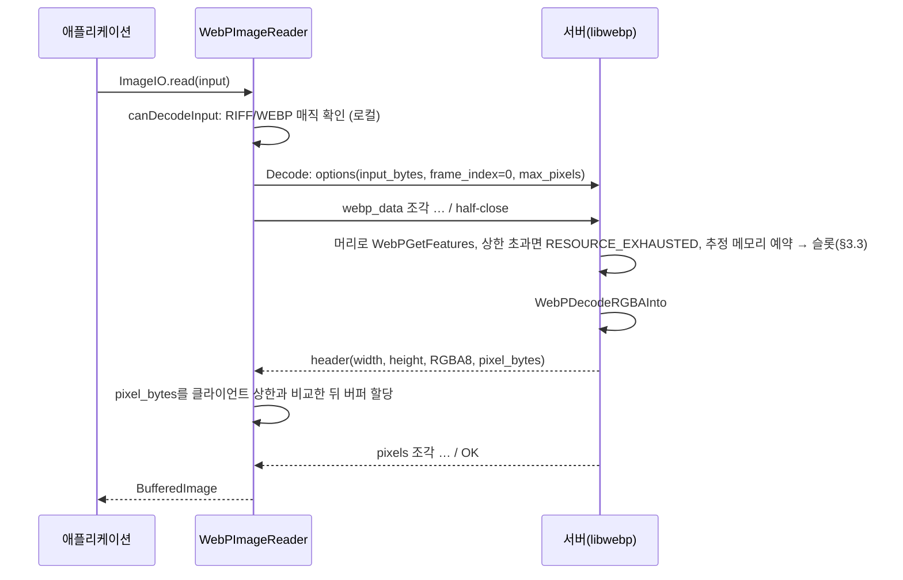

# gRPC API 설계 (`webp.v1`)

- 상태: 초안. 기반 결정(ADR-0003, ADR-0004)은 accepted. Phase 1~3 구현 중에 갱신한다.
- 정의 파일: [proto/webp/v1/webp_service.proto](../../proto/webp/v1/webp_service.proto), [proto/webp/v1/image.proto](../../proto/webp/v1/image.proto)
- 관련: [ADR-0003 전송 방식](../adr/0003-transport.md), [ADR-0004 픽셀 전송 포맷](../adr/0004-pixel-transfer-format.md), [목표와 제약](goals-and-constraints.md)

## 1. 서비스 개요

| RPC | 형태 | 용도 | ImageIO 대응 |
|---|---|---|---|
| `GetInfo` | unary | 서버·libwebp 버전, 서버 상한 | 클라이언트 초기화, 진단 |
| `GetFeatures` | 클라이언트 스트리밍 | 크기, alpha, 애니메이션 정보, 메타데이터 (픽셀 디코딩 없음) | `getNumImages`, `getWidth`, `getHeight`, `getImageMetadata`, `getStreamMetadata` |
| `Decode` | 양방향 (half-duplex) | 정지 이미지 또는 합성된 i번째 프레임 하나 | `read(i)` |
| `DecodeAnimation` | 양방향 (half-duplex) | 합성된 프레임을 0번부터 차례로 | 순차 프레임 읽기 |
| `Encode` | 양방향 (half-duplex) | 정지 이미지 인코딩 + 메타데이터 삽입 | `ImageWriter.write` |
| `EncodeAnimation` | 양방향 (half-duplex) | 애니메이션 인코딩 | `prepareWriteSequence` / `writeToSequence` / `endWriteSequence` |
| `grpc.health.v1.Health/Check`, `Watch` | 표준 | 헬스체크 | 클라이언트 진단, 컨테이너 probe |

헬스체크를 따로 정의하지 않고 표준 [gRPC Health Checking Protocol](https://github.com/grpc/grpc/blob/master/doc/health-checking.md)을 쓴다. 서버 구현 후보 언어(Rust `tonic-health`, Go `google.golang.org/grpc/health`) 모두 구현체를 제공한다(상세: [docs/research/0003](../research/0003-server-language-rust-vs-go.md)).

`canDecodeInput`은 RPC를 쓰지 않는다. 입력 앞 12바이트가 `RIFF` + 4바이트 크기 + `WEBP`인지 로컬에서만 검사한다(RFC 9649 §2.4).

## 2. 스트리밍 규칙

### 2.1 왜 스트리밍인가

압축 해제된 RGBA는 크다. 3840×2160 한 장이 33,177,600바이트로, gRPC 기본 수신 한도(4MB)의 8배다. 한도를 올리는 대신 모든 큰 데이터를 조각으로 나눈다. 그러면 **어떤 메시지도 기본 한도를 넘지 않는다**는 불변식이 생기고, 클라이언트와 서버 어느 쪽도 메시지 한도를 조정할 필요가 없다. 근거와 대안 비교는 ADR-0003.

### 2.2 메시지 순서

모든 스트리밍 RPC는 같은 모양을 따른다.

```
요청:  options ─ data ─ data ─ … ─ (half-close)
응답:                                  header ─ data ─ data ─ … ─ (status OK)
```

- 요청 첫 메시지는 `options`(oneof), 이후는 데이터 조각이다. 순서가 어긋나면 `INVALID_ARGUMENT`.
- 서버는 요청 스트림이 닫힌 뒤 응답을 시작한다(half-duplex). 입력 전체가 있어야 libwebp가 디코딩할 수 있기 때문이다(`WebPAnimDecoderNew`는 비트스트림 전체를 요구한다 — libwebp `src/webp/demux.h`).
- 응답 헤더(`FrameHeader.pixel_bytes`, `EncodedHeader.webp_bytes`)가 뒤따를 조각의 바이트 합계를 선언한다. 수신 측은 이 값을 상한과 비교한 뒤에 버퍼를 할당한다.
- 조각 하나의 크기는 1바이트 이상 `Limits.max_chunk_bytes` 이하다. 조각 경계는 행 경계와 맞지 않을 수 있다.
- 애니메이션 응답(`DecodeAnimation`)은 `features` 다음에 프레임마다 `frame` 헤더 + 픽셀 조각들이 반복된다.
- 애니메이션 요청(`EncodeAnimation`)은 프레임 수를 미리 알리지 않는다. ImageIO 시퀀스 쓰기는 `endWriteSequence` 전까지 프레임 수를 모르기 때문이다. 서버가 받는 대로 세고 상한을 넘으면 거부한다.

### 2.3 Decode 시퀀스 (정지 이미지)



### 2.4 애니메이션 읽기

- `getNumImages(true)`는 `GetFeatures`의 `frame_count`를 쓴다.
- `read(i)`는 `Decode(frame_index = i)`를 쓴다. 서버는 0번부터 i번까지 합성한다(`WebPAnimDecoder`는 순차 합성만 지원). 그래서 `read(0)`, `read(1)`, … 를 차례로 부르면 총 비용이 O(n²)이다.
- 합성 결과는 libwebp `WebPAnimDecoder` 동작을 따른다. libwebp는 ANIM 배경색을 무시하고 캔버스를 투명으로 초기화한다([research/0005](../research/0005-test-samples.md)). 배경색은 `AnimationInfo.background_color_argb`로 따로 알린다.
- 순차 읽기 효율을 위해 `DecodeAnimation`을 둔다. 정책은 [ADR-0014](../adr/0014-animation-and-metadata-mapping.md)를 따른다: 리더가 입력 하나에 스트림 하나를 열어 두고, `read(i)`가 바로 앞 프레임 + 1이면 그 스트림에서 다음 프레임을 받고, 그 밖에는 스트림을 취소하고 `Decode(frame_index = i)`를 쓴다. 열어 둔 스트림은 서버 동시 처리 슬롯을 차지하므로 `setInput`/`reset`/`dispose`에서 바로 취소한다.

### 2.5 동시 처리 슬롯과 HTTP/2 흐름 제어

서버는 요청마다 메모리 예약과 동시 처리 슬롯(`max_concurrency`, 기본 2)을 잡은 뒤에야 입력을 읽는다. 입력 버퍼를 예산과 슬롯 안에서만 잡으려는 것이다(Phase 1, ADR-0016). 디코딩 RPC는 메모리 추정에 필요한 머리(64바이트, 대개 첫 조각 하나)만 먼저 읽는다(§3.3). 기다리는 요청이 그 뒤에 보낸 데이터는 읽히지 않은 채 그 연결의 HTTP/2 수신 창을 차지한다.

- **교착 조건**: 한 연결(클라이언트 JVM의 채널 하나)에서 대기 요청들의 데이터가 연결 수신 창을 다 쓰면, 슬롯을 가진 요청도 더 보낼 수 없다. 끝나지 못하니 슬롯도 풀리지 않는다.
- **발견 경위**: hyper 기본값(연결 창 = 스트림 창 = 1 MiB)에서는 대기 요청 하나로 이 교착이 났다. GIF 변환 동시 부하 측정에서 동시 4건 이상이 모두 데드라인을 넘었다(research/0012).
- **규칙**: 서버는 `연결 창 ≥ 2 × 최대 동시 스트림 × 스트림 창`을 지킨다(`server/src/lib.rs`, 컴파일 시점 검사).

| 설정 | 값 |
|---|---|
| 스트림 수신 창 | 256 KiB |
| 연결당 최대 동시 스트림 | 64(넘는 요청은 클라이언트가 기다린다) |
| 연결 수신 창 | 32 MiB |

- 대기 스트림이 쥘 수 있는 양은 최대 16 MiB이고, 슬롯을 가진 요청에는 같은 크기의 여유가 남는다. 업로드 처리량은 바뀌지 않았다(인코딩 M·XL, 측정 오차 안).
- 응답 방향(서버 → 클라이언트)은 클라이언트(grpc-java)의 창을 쓴다. 한 스트림이 응답을 읽지 않고 멈춰도 같은 연결의 다른 요청이 끝나는 것을 확인했다(`FlowControlIntegrationTest`).

## 3. 상한과 decompression bomb 방어

| 상한 (`Limits`) | 의미 | 서버 검사 시점 | 기본값 (초안) |
|---|---|---|---|
| `max_input_bytes` | 압축 입력 크기 | `options.input_bytes` 수신 즉시, 조각 수신 중 누적값 | 64 MiB |
| `max_pixels` | 캔버스 width × height | 헤더 파싱 직후, 픽셀 버퍼 할당 전 | 8192 × 8192 (67,108,864) |
| `max_frames` | 애니메이션 프레임 수 | demux 직후(디코딩), 프레임 수신 중(인코딩) | 1,000 |
| `max_metadata_bytes` | ICC+EXIF+XMP 합 | demux 직후, `options` 수신 즉시(인코딩) | 2 MiB |
| `max_chunk_bytes` | 조각 하나 크기 | 조각 수신마다 | 1 MiB (ADR-0003) |
| `max_composited_pixels` | 합성 픽셀 수: 캔버스 width × height × 프레임 수 | 디코딩: 헤더·프레임 목록만 읽은 뒤 디코더를 만들기 전(`Decode`는 요청한 프레임 번호 + 1까지). 인코딩: 프레임을 받을 때마다 누적 | 2^30 (1,073,741,824) ([ADR-0017](../adr/0017-output-volume-limits.md)) |

- **상한은 서버 설정값이다**(결정 2026-10-23). 코드에 고정하지 않고 서버가 시작할 때 설정에서 읽어 적용하며, `GetInfo`의 `Limits`로 그대로 노출한다. 설정 키는 §3.1, 기본값은 [ADR-0012](../adr/0012-server-runtime-config.md).
- 서버는 시작할 때 설정값을 검사한다. `max_chunk_bytes`와 `max_metadata_bytes`는 메시지 하나에 실리므로 gRPC 기본 메시지 한도(4MB)보다 작아야 한다(ADR-0003의 불변식). 어기면 시작하지 않는다.
- 픽셀 수 상한이 필요한 근거: VP8X 캔버스만 16384×16384로 바꾼 298바이트짜리 유효한 애니메이션 파일 하나로 디코더가 1GiB 할당을 시도한다([research/0005](../research/0005-test-samples.md) "손상/악성 입력").
- **기본값 근거(측정 2026-10-23, [research/0007](../research/0007-server-memory-budget.md))**: 컨테이너 1 GiB·동시 처리 2에서 8192² 정지 이미지 디코딩 두 개를 동시에 처리해도 최고 661 MiB로 안에 든다. 인코딩은 libwebp 인코더가 픽셀당 약 31–36 B를 써서 8192² 하나로도 OOM이다. 이 OOM은 메모리 예산 기반 허용([ADR-0016](../adr/0016-memory-budget-admission.md), §3.3)으로 막는다.
- 클라이언트는 `DecodeOptions.max_pixels`로 더 엄격한 상한을 보낼 수 있다. 서버는 둘 중 작은 값을 적용한다.
- 클라이언트도 응답 `FrameHeader`를 받으면 할당 전에 다시 검증한다. Java 배열 한도(약 2^31 원소) 때문에 RGBA8 `byte[]` 하나로는 약 5.3억 픽셀을 넘을 수 없다. libwebp 최대 크기(16383 × 16383 ≈ 2.7억 픽셀)는 그 안에 든다.
- 정지 이미지는 `WebPGetFeatures`로, 애니메이션은 `WebPDemux`의 캔버스 크기와 프레임 수로 검사한다.
- **요청당 작업량**(ADR-0017): `max_composited_pixels`는 출력량 폭탄(작은 캔버스·많은 프레임처럼 하나하나는 상한 안이지만 곱이 큰 파일)을 픽셀을 만들기 전에 거부한다. 이와 별도로 서버는 요청마다 시간 상한(`max_request_ms`)과 대기 상한(`max_queued_requests`)을 둔다(§3.2).

### 3.1 서버 설정 키

설정 방식은 [ADR-0012](../adr/0012-server-runtime-config.md)를 따른다: 명령줄 인자와 환경변수로 같은 키를 받고, 우선순위는 명령줄 인자 → 환경변수 → 기본값이다. 키 이름은 Phase 1 구현에서 바뀔 수 있으며, 바뀌면 이 표를 함께 고친다.

| 명령줄 인자 | 환경변수 | 기본값 | 의미 |
|---|---|---|---|
| `--uds-path` | `WEBP_SERVER_UDS_PATH` | `/run/webp-imageio/webp.sock` | UDS 리슨 경로 |
| `--uds-mode` | `WEBP_SERVER_UDS_MODE` | `0660` | 소켓 파일 모드 |
| `--tcp-addr` | `WEBP_SERVER_TCP_ADDR` | 없음(TCP 꺼짐) | TCP 리슨 주소. 권장 `127.0.0.1:50051` |
| `--max-input-bytes` | `WEBP_SERVER_MAX_INPUT_BYTES` | `67108864` (64 MiB) | `Limits.max_input_bytes` |
| `--max-pixels` | `WEBP_SERVER_MAX_PIXELS` | `67108864` (8192²) | `Limits.max_pixels` |
| `--max-frames` | `WEBP_SERVER_MAX_FRAMES` | `1000` | `Limits.max_frames` |
| `--max-metadata-bytes` | `WEBP_SERVER_MAX_METADATA_BYTES` | `2097152` (2 MiB) | `Limits.max_metadata_bytes` |
| `--max-chunk-bytes` | `WEBP_SERVER_MAX_CHUNK_BYTES` | `1048576` (1 MiB) | `Limits.max_chunk_bytes` |
| `--max-concurrency` | `WEBP_SERVER_MAX_CONCURRENCY` | `2` | 동시에 libwebp 작업을 하는 요청 수 |
| `--buffer-pool-bytes` | `WEBP_SERVER_BUFFER_POOL_BYTES` | `134217728` (128 MiB) | 정지 이미지 출력 버퍼 풀 총량 상한, 0이면 끔([ADR-0018](../adr/0018-decode-output-buffer-pool.md)) |
| `--buffer-pool-idle-ms` | `WEBP_SERVER_BUFFER_POOL_IDLE_MS` | `30000` | 풀 버퍼 유휴 만료(ADR-0018) |
| `--max-composited-pixels` | `WEBP_SERVER_MAX_COMPOSITED_PIXELS` | `1073741824` (2^30) | `Limits.max_composited_pixels`. 요청 하나의 합성 픽셀 수(캔버스 × 프레임) 상한([ADR-0017](../adr/0017-output-volume-limits.md)) |
| `--max-request-ms` | `WEBP_SERVER_MAX_REQUEST_MS` | `60000` | 슬롯을 잡은 뒤 요청 하나의 시간 상한(ADR-0017) |
| `--max-queued-requests` | `WEBP_SERVER_MAX_QUEUED_REQUESTS` | `8` | 메모리나 슬롯을 기다릴 수 있는 요청 수, 0이면 상한 없음(ADR-0017) |
| `--max-memory-bytes` | `WEBP_SERVER_MAX_MEMORY_BYTES` | `805306368` (768 MiB) | 요청들과 출력 버퍼 풀이 함께 쓸 메모리 합계. `buffer_pool_bytes`보다 커야 한다([ADR-0016](../adr/0016-memory-budget-admission.md), §3.3) |

로그 수준은 `RUST_LOG` 환경변수로 정한다(Rust `tracing` 관례).

- 기본값 조합의 메모리 예산 위험(애니메이션 디코더가 캔버스 버퍼 2개를 쓴다)은 ADR-0012 "결과"를 본다.

### 3.2 요청 시간 상한과 대기 상한

[ADR-0017](../adr/0017-output-volume-limits.md). `Limits`에는 넣지 않는다(입력 검사가 아니라 서버 운영 정책이다).

| 정책 | 정의 | 넘을 때 |
|---|---|---|
| `max_request_ms` | 동시 처리 슬롯을 잡은 때부터 응답을 다 보낼 때까지의 벽시계 시간. 입력 조각 수신, 프레임 사이, 응답 조각 전송이 모두 남은 시간만큼만 기다린다 | `DEADLINE_EXCEEDED`("request exceeded max_request_ms on the server")로 끝내고 슬롯을 놓는다. 이미 보낸 응답 뒤에 오류가 오므로 클라이언트는 잘린 응답을 정상 끝으로 보지 않는다 |
| `max_queued_requests` | 메모리나 슬롯을 기다리는 요청 수(서버 전체). 디코딩 RPC가 머리를 읽는 동안도 센다(§3.3) | 기다리지 않고 바로 `UNAVAILABLE`("server busy: N requests queued ...; retry later") |

- 시간 상한은 libwebp 함수 한 번(정지 이미지 디코딩·인코딩 한 번) 안에서는 멈추지 못한다. 그 시간은 `max_pixels`가 묶는다.
- 대기 중인 요청이 취소되면 대기 자리도 바로 돌려준다.
- 모든 RPC는 첫 메시지(`options`)를 받아 선언 크기를 검사한 뒤 메모리와 슬롯을 잡는다. 시간 상한은 슬롯을 잡은 때부터 잰다. 메모리와 슬롯을 기다리는 시간은 클라이언트 데드라인만 묶는다. 디코딩 RPC의 머리 읽기는 `max_request_ms`까지만 기다린다.

### 3.3 메모리 예산

[ADR-0016](../adr/0016-memory-budget-admission.md). 요청마다 추정 메모리를 예산에서 예약하고, 예약할 수 있어야 슬롯을 잡는다. `Limits`에는 넣지 않는다(§3.2와 같은 운영 정책이다).

- **예산**: `max_memory_bytes`(기본 768 MiB)에서 출력 버퍼 풀 총량 상한(`buffer_pool_bytes`, 기본 128 MiB)을 **고정으로** 뺀 값이다. 기본값으로 요청들이 640 MiB를 나눠 쓴다. 풀은 자기 상한 안에서 따로 관리하므로 둘의 합이 `max_memory_bytes`를 넘지 않는다.
  - ADR-0016의 "예약할 수 없으면 풀을 비우고 다시 시도한다"는 구현하지 않는다. 고정으로 빼면 풀을 비워도 예약 가능량이 늘지 않기 때문이다(결정자 확인 2026-10-29).
- **추정식**(단위: 바이트, `px` = 캔버스 픽셀 수):

| RPC | 추정 | 예약 시점 |
|---|---|---|
| GetFeatures | 입력 크기 | `options` 뒤 |
| Decode, DecodeAnimation | 입력 크기 + 6 × px(정지 이미지), 10 × px(애니메이션) | 머리를 읽은 뒤. 입력을 다 받은 뒤 다시 세어 모자라면 더 예약한다 |
| Encode | 40 × px(입력 버퍼 포함) | `options` 뒤 |
| EncodeAnimation | 60 × px + 프레임마다 1 × px(lossless), 0.25 × px(lossy) | 캔버스 몫은 `options` 뒤, 프레임 몫은 프레임을 받을 때마다 |

- **순서**: 메모리 예약을 먼저 기다리고, 그다음 슬롯을 기다린다. 메모리를 못 잡은 요청은 슬롯을 차지하지 않는다. 메모리는 먼저 온 요청부터 받는다(큰 요청이 굶지 않는다).
- **거부**: 혼자서도 예산을 넘는 요청은 기다리지 않고 `RESOURCE_EXHAUSTED`("estimated memory N bytes exceeds the memory budget ...")로 거부한다. 기본값으로 정지 이미지 인코딩은 4096²까지 들어간다(40 × 4096² = 640 MiB). 캔버스가 8192²인 애니메이션 디코딩은 거부된다(10 × 8192² = 640 MiB에 입력 크기가 더해진다). 8192² 정지 이미지 디코딩은 약 448 MiB(입력 64 MiB 포함)로 들어간다. 애니메이션 인코딩은 캔버스 약 1,118만 픽셀(약 3344²)까지이고, 프레임 몫만큼 더 작아진다.
- **요청 중간의 추가 예약은 기다리지 않는다**: 애니메이션 인코딩의 프레임 몫, 그리고 디코딩에서 입력을 다 받은 뒤 다시 센 추정치가 머리로 센 값보다 클 때다. 모자라면 `RESOURCE_EXHAUSTED`("memory budget exhausted ...")로 끝내고 잡은 예약과 슬롯을 놓는다. 슬롯과 예약을 쥔 채 기다리면 서로 놓기를 기다리는 교착이 생기기 때문이다.
- **머리 먼저 읽기**(디코딩 RPC): 캔버스 크기는 데이터 안의 헤더에만 있다. 그래서 대기 자리를 먼저 잡고 머리(64바이트 이상, 대개 첫 조각 하나)를 받는다. 그 뒤에 추정치를 예약하고 슬롯을 잡는다.
  - 머리를 들고 기다리는 요청 수도 대기 상한(§3.2)으로 묶인다. 요청 하나가 드는 머리는 조각 몇 개, 최대 `max_chunk_bytes` 남짓이다.
  - 머리에서 캔버스가 `max_pixels`를 넘으면 나머지를 받기 전에 거부한다.
  - 머리에서 헤더를 읽지 못하면(손상, 아주 작은 조각) 입력 크기만 예약한다. 헤더 오류는 입력을 다 받은 뒤 이전처럼 낸다.
- **예약의 수명**: 정지 이미지 디코딩과 인코딩은 예약을 응답 버퍼에 붙인다. 응답 조각이 모두 해제되어 버퍼가 풀로 돌아가거나 해제된 뒤에 예약이 풀린다. 애니메이션 디코딩은 디코더가 끝날 때 풀린다. 응답 스트림이 끝나면(정상이든 시간 상한이든) 서버는 아직 읽히지 않은 응답 조각을 바로 버린다.
- **한계**: 추정식은 측정 기반 근사다(research/0007, research/0012). libwebp 버전이나 인코더 설정이 바뀌면 다시 잰다. 아래는 예산 밖이다.
  - 응답 채널에 있는 애니메이션 프레임 조각 사본: 요청마다 최대 4 × `max_chunk_bytes`.
  - gRPC 전송 버퍼.

## 4. 오류 매핑

서버는 gRPC status code와 영어 메시지로 오류를 알린다. v1에서는 `google.rpc` 상세(error details)를 쓰지 않는다(필요해지면 추가 — 열린 질문 참고).

| 상황 | status | libwebp 원인 예 | 클라이언트 처리 |
|---|---|---|---|
| 서버에 연결할 수 없음, 서버 재시작·크래시, 종료 중 | `UNAVAILABLE` | (프로세스 크래시) | `IIOException("WebP server unavailable (<endpoint>)...", cause)` |
| 서버 혼잡: 대기 상한 초과(ADR-0017) | `UNAVAILABLE`, 메시지가 "server busy"로 시작 | - | `IIOException("WebP server busy (<endpoint>)...", cause)`. 앱이 물러섰다가 다시 시도한다 |
| 클라이언트 데드라인 초과 | `DEADLINE_EXCEEDED` | - | `IIOException("WebP server timed out after <n> ms (<rpc>)", cause)` |
| 서버 요청 시간 상한 초과(ADR-0017) | `DEADLINE_EXCEEDED`, 메시지에 "max_request_ms" | - | `IIOException("WebP server request time limit exceeded (<rpc>)...", cause)` |
| WebP가 아님, 손상, 잘림 | `INVALID_ARGUMENT` | `VP8_STATUS_BITSTREAM_ERROR`, `VP8_STATUS_NOT_ENOUGH_DATA`, `VP8_STATUS_UNSUPPORTED_FEATURE`, `WEBP_MUX_BAD_DATA` | `IIOException("Invalid or corrupted WebP data: <message>", cause)` |
| 프로토콜 위반 (메시지 순서, 선언 크기 불일치, 조각 크기 초과), 잘못된 옵션 | `INVALID_ARGUMENT` | - | `IIOException` (클라이언트 버그이므로 메시지에 RPC 이름 포함) |
| 서버 상한 초과 | `RESOURCE_EXHAUSTED` | - | `IIOException("WebP image exceeds server limit: <message>", cause)` |
| 메모리 예산 초과(ADR-0016): 혼자서도 예산을 넘는 요청("estimated memory"), 요청 중간의 추가 예약 실패("memory budget exhausted") | `RESOURCE_EXHAUSTED` | - | 위와 같음. 추가 예약 실패는 혼잡 때문이라 다시 시도하면 될 수 있다 |
| 메모리 할당 실패 | `RESOURCE_EXHAUSTED` | `VP8_STATUS_OUT_OF_MEMORY`, `WEBP_MUX_MEMORY_ERROR` | 위와 같음. libwebp 1.6.0은 일부 손상 파일(ALPH 예약 비트, ALPH 압축 방식 2)에도 `VP8_STATUS_OUT_OF_MEMORY`를 돌려주므로 메시지에 그 가능성을 적는다(samples/manifest.json) |
| 프레임 번호 범위 밖 | `OUT_OF_RANGE` | - | 클라이언트가 먼저 `IndexOutOfBoundsException`을 던진다(ImageReader 규약). 서버 응답은 방어선이다. |
| 아직 구현하지 않은 RPC | `UNIMPLEMENTED` | - | `IIOException` |
| 그 밖의 서버 내부 오류 | `INTERNAL` | `VP8_STATUS_INVALID_PARAM`(서버 버그) | `IIOException` |
| 클라이언트 취소 | `CANCELLED` | `VP8_STATUS_USER_ABORT` | 호출 측 중단 처리 |

핵심은 **서버 불가(`UNAVAILABLE`/`DEADLINE_EXCEEDED`)와 입력 문제(`INVALID_ARGUMENT`/`RESOURCE_EXHAUSTED`)를 메시지만 보고도 구분할 수 있게** 하는 것이다. 클라이언트는 `StatusRuntimeException`을 항상 cause로 넘긴다.

## 5. 클라이언트 설정

SPI는 ImageIO가 인자 없는 생성자로 만든다. 그래서 기본 설정 경로는 시스템 프로퍼티와 환경변수다. 코드로도 줄 수 있다([ADR-0020](../adr/0020-imageio-config-injection.md)). 항목마다 아래 순서로 처음 정해진 값을 쓴다.

1. 리더·writer 단위: `createReaderInstance(WebPClientConfig)` / `createWriterInstance(WebPClientConfig)`
2. 등록 단위: `WebPImageReaderSpi(WebPClientConfig)` / `WebPImageWriterSpi(WebPClientConfig)`를 수동 등록. 레지스트리는 클래스마다 하나만 두므로 자동 등록된 SPI를 대체하고, JVM에 하나뿐이다
3. 시스템 프로퍼티
4. 환경변수
5. 기본값

| 설정 | `WebPClientConfig` | 시스템 프로퍼티 | 환경변수 | 기본값 (초안) |
|---|---|---|---|---|
| 엔드포인트 (gRPC target) | `endpoint` | `webp.imageio.endpoint` | `WEBP_IMAGEIO_ENDPOINT` | `unix:///run/webp-imageio/webp.sock` |
| 호출 데드라인(혼잡 재시도 포함) | `deadlineMs` | `webp.imageio.deadline-ms` | `WEBP_IMAGEIO_DEADLINE_MS` | `30000` |
| 클라이언트 픽셀 상한 | `maxPixels` | `webp.imageio.max-pixels` | `WEBP_IMAGEIO_MAX_PIXELS` | 없음 (서버 상한만 적용) |
| 혼잡 재시도 횟수 | `busyRetries` | `webp.imageio.busy-retries` | `WEBP_IMAGEIO_BUSY_RETRIES` | `0`(끔), 최대 10 |

- 엔드포인트는 gRPC target 문자열이다. UDS는 `unix:///절대/경로`, TCP는 `dns:///host:port` 또는 `host:port`.
- 기본 엔드포인트와 Windows 개발 환경 처리는 ADR-0003을 따른다.
- **호출 단위**: `WebPReadParam`(리더의 `getDefaultReadParam()`)으로 그 읽기의 데드라인과 클라이언트 픽셀 상한을 바꾼다. `WebPWriteParam`(writer의 `getDefaultWriteParam()`)은 표준 압축 항목에 더해 `EncodeParams.method`(0–6)를 넘긴다.
- **혼잡 재시도**(`busyRetries` ≥ 1): `UNAVAILABLE`이고 메시지가 "server busy"로 시작하는 거부(§3.2, 서버가 일을 시작하기 전)만 다시 보낸다.
  - 대상: GetFeatures, Decode, DecodeAnimation 시작, Encode.
  - 물러섬: 100 ms에서 두 배씩, 최대 1,600 ms.
  - 시도와 물러섬을 합쳐 호출 데드라인 안이다. 남은 시간이 다음 물러섬보다 짧으면 멈춘다.
  - EncodeAnimation은 프레임을 받는 대로 보내므로 다시 시도하지 않는다.
  - 접속 불가, 메모리 예산 소진(§3.3, 일하던 중의 실패), 데드라인 초과도 다시 시도하지 않는다.

## 6. 언어별 생성 옵션

proto 파일에는 `java_package`, `go_package` 같은 언어별 옵션을 넣지 않는다. 생성할 때 지정한다.

- Rust(서버): prost/tonic은 패키지 `webp.v1`을 그대로 모듈로 쓴다(`server/build.rs`).
- Java(클라이언트): Gradle `prepareProto` 작업이 proto 사본의 `package webp.v1;` 다음 줄에 `option java_package = "net.rivergod.webp.imageio.proto.v1"; option java_multiple_files = true;`를 넣은 뒤 protoc를 돌린다(`client-jvm/build.gradle.kts`). ADR-0013은 buf managed mode를 수단으로 적었지만, Gradle의 protoc 경로에는 managed mode가 없어 같은 결과(패키지 이름, 원본에 언어 옵션 없음)를 이 방식으로 얻는다.

## 7. 검증

```sh
# 저장소 루트에서. 로컬에 buf가 없으면 Docker로 실행한다.
docker run --rm --network none -e BUF_CACHE_DIR=/tmp/buf-cache \
  -v "$PWD:/workspace:ro" -w /workspace bufbuild/buf:1.75.0 lint
```

`buf.yaml`은 `STANDARD`와 `COMMENTS` 규칙을 쓴다. `COMMENTS`가 서비스, RPC, 메시지, 필드, oneof, enum, enum 값의 주석 누락을 잡는다([주석 규칙](../conventions/code-documentation.md)).

## 8. 열린 질문

| 질문 | 현재 판단 | 정할 때 |
|---|---|---|
| Java에서 클라이언트/양방향 스트리밍을 어떻게 동기 API(ImageReader)로 감쌀까 | 결정됨(Phase 2): async 스텁 + 흐름 제어를 지키는 동기 어댑터(`client-jvm/.../StreamingCall.java`). 보내는 쪽은 `isReady`/`onReadyHandler`로 기다리고, 응답은 gRPC 콜백에서 바로 처리한다. | - |
| 같은 입력을 RPC마다 다시 보내는 비용 | `GetFeatures` 다음 `Decode`에서 압축 입력을 두 번 보낸다. 압축 데이터는 작고 UDS라 우선 허용한다. 서버 쪽 세션/핸들 캐시는 상태가 생겨 단순함을 해치므로 측정 후 판단한다. | Phase 4 |
| 오류 상세 (`google.rpc.ErrorInfo`) | v1은 status code + 메시지만 쓴다. 클라이언트가 상한 종류 같은 구조화 정보를 필요로 하면 추가한다. | Phase 2 |
| 공유 메모리 전송 (memfd + UDS fd 전달) | gRPC 밖의 최적화다. 벤치마크에서 복사 비용이 지배적일 때만 검토한다. | Phase 4 이후 |
| 애니메이션 순차 읽기 정책 | 결정·구현됨: [ADR-0014](../adr/0014-animation-and-metadata-mapping.md), [imageio-metadata.md §4](imageio-metadata.md) | - |
| ICC 색 변환을 클라이언트에서 할까 | 결정됨: 적용하지 않고 메타데이터로만 제공([ADR-0014](../adr/0014-animation-and-metadata-mapping.md)) | - |
| Java 클라이언트의 JNI 없는 UDS | 확인됨(Phase 2 PoC): 동작한다. `--illegal-native-access=deny`에서도 동작하고, native epoll 경로보다 약 5–9% 느리다. `:authority`를 `localhost`로 덮어써야 한다([research/0008](../research/0008-java-uds-poc.md)). ADR-0003 유지. | - |
| gRPC 채널 수명 | 기본값: 처음 쓸 때 만드는 공유 채널 하나, 데몬 스레드([client-jvm/README.md](../../client-jvm/README.md)). JDK 26부터 레지스트리 GC 시 `onDeregistration`이 호출되지 않으므로 정리를 거기에 맡기지 않는다([research/0004](../research/0004-jdk-baseline.md)). 데몬 스레드를 쓰는 등 JVM 종료를 막지 않는 방식을 정한다. | Phase 2 |
