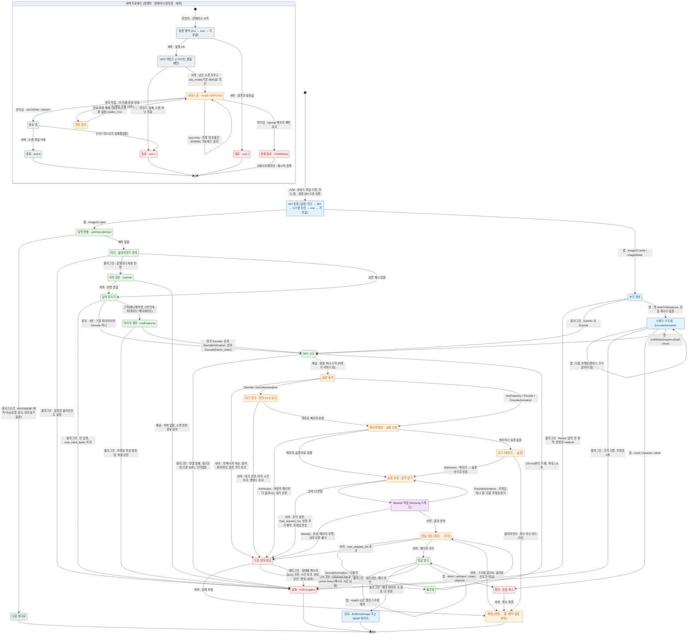

# 사용 흐름 상태도: 상태 · 전이 · 주체

이 프로젝트를 쓸 때 생기는 일을 상태와 전이로 그린다. 서버 프로세스의 생명주기 하나와, 연산 하나(이미지 한 장 읽기 또는 쓰기)가 앱 → 플러그인 → 서버 → libwebp를 지나 끝나는 모든 갈래를 담는다. 계약과 상한의 정의는 [grpc-api.md](grpc-api.md)가 원본이고, 이 문서는 그것을 한눈에 보는 그림이다.

## 읽는 법

- 전이 이름표는 `주체 · 사건 [조건]` 형식이다. 주체를 적지 않은 전이는 앞 상태의 주체가 이어서 한다.
- 상태 색은 그 상태를 쥔 주체다.
  - 파랑: 앱(애플리케이션 코드, JVM)
  - 초록: ImageIO 플러그인(리더·라이터, gRPC 채널)
  - 주황: 서버(허용 제어, 핸들러, 정리 작업)
  - 보라: libwebp(서버의 blocking 스레드)
  - 회색: 운영자·컨테이너 런타임
  - 빨강: 실패·중단
- 클라이언트 상태와 서버 상태는 실제로는 동시에 진행한다. 그림은 둘을 연산 하나의 경로로 이어 그렸다. 예를 들어 플러그인이 "RPC 시도"에 있는 동안 서버는 "옵션 검사"부터 "응답 전송"까지 지난다.
- "서버 프로세스"는 따로 돈다. 요청 흐름("옵션 검사"부터 "해제"까지)은 서버가 "서비스 중"일 때만 들어간다. 아니면 채널 단계에서 실패한다("WebP server unavailable").
- 서버의 오류 상태는 모두 클라이언트에서 `IIOException`이 된다. 상태별 메시지는 [grpc-api.md §4](grpc-api.md)와 `client-jvm/src/main/java/net/rivergod/webp/sidecar/GrpcErrors.java`에 있다. 혼잡 거부(`UNAVAILABLE` "server busy")만 설정한 횟수만큼 다시 시도한다([ADR-0020](../adr/0020-imageio-config-injection.md), 기본 0회).

## 상태도

## 근거

| 영역 | 근거 |
|---|---|
| 서버 시작·종료, 정리 작업 | `server/src/main.rs`(설정 오류 exit 2, 실행 오류 exit 1, SIGTERM·SIGINT, 소켓 정리, 정리 주기), `server/src/config.rs` |
| 허용 제어(대기 상한, 메모리 예산, 슬롯, 시간 상한) | `server/src/admission.rs`, [ADR-0016](../adr/0016-memory-budget-admission.md), [ADR-0017](../adr/0017-output-volume-limits.md) |
| 요청 처리(옵션, 머리 읽기, 상한, 응답 조각, 오류 매핑) | `server/src/service.rs`, `server/src/webp.rs`, [grpc-api.md](grpc-api.md) §2–§4 |
| 출력 버퍼 풀, 유휴 힙 반환 | `server/src/pool.rs`, `server/src/heap.rs`, [ADR-0018](../adr/0018-decode-output-buffer-pool.md), [ADR-0021](../adr/0021-glibc-distroless-image.md) |
| 플러그인(SPI, 입력 판별, 설정 우선순위, RPC 순서, 재시도, 데드라인) | `client-jvm/src/main/java/net/rivergod/webp/sidecar/`(`WebPImageReaderSpi`, `WebPImageReader`, `WebPImageWriter`, `WebPClient`, `StreamingCall`, `AnimationStream`, `GrpcErrors`, `ClientConfig`), [ADR-0013](../adr/0013-client-package-and-imageio-mapping.md), [ADR-0014](../adr/0014-animation-and-metadata-mapping.md), [ADR-0020](../adr/0020-imageio-config-injection.md) |
| 컨테이너(seccomp EPERM, 메모리 제한, 소켓 권한·경로 길이, 재시작 정책) | [deploy/README.md](../../deploy/README.md), `deploy/compose.yaml` |

확인 날짜: 2026-11-03(커밋 `800cf9e` 기준). 코드를 바꿔 상태나 전이가 달라지면 이 그림을 같은 커밋에서 고친다.

## 그림에 없는 것, 정해지지 않은 것

- 종료 중에 처리 중이던 요청을 어떻게 끝내는지는 저장소가 정하지 않았다. tonic의 graceful shutdown 동작을 따르고, 기다리는 시간 상한도 없다(미확인). health 상태도 종료 전에 `NOT_SERVING`으로 바꾸지 않는다.
- 서버에는 `UNAVAILABLE` "server is shutting down" 응답이 정의돼 있지만(`server/src/admission.rs`), 허용 제어의 세마포어를 닫는 코드가 없어 지금은 이 상태에 이르지 않는다. 그래서 그림에 넣지 않았다.
- 소켓 권한(그룹 65532 아님)으로 연결이 거부될 때 클라이언트가 받는 메시지는 문서에 없다. 코드로 보면 "unavailable"로 매핑된다(추정).
- 오케스트레이터의 재시작은 `deploy/compose.yaml`의 `restart: unless-stopped`만 있다. compose 파일은 compose로 실행해 검증하지 않았다(`deploy/compose.yaml` 머리 주석).
